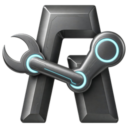

# ArmSwing

**Balanceo natural de brazos para el seguimiento de cuerpo completo en VRChat.**

[English](README.md) | [日本語](README.ja.md) | [한국어](README.ko.md) | [简体中文](README.zh-CN.md) | Español | [Português (BR)](README.pt-BR.md) | [Русский](README.ru.md)

En VRChat con seguimiento de cuerpo completo (FBT), al caminar con el joystick
los brazos se quedan rígidos mientras el cuerpo se desliza. ArmSwing entrega
tus brazos bajados a la propia animación de caminar de VRChat mientras
caminas, así que se balancean con naturalidad. Levanta una mano, o mantén
pulsado su gatillo o grip, y ese brazo vuelve a seguir tu mando en el mismo
fotograma.

## Requisitos

- Windows 10 (versión 1809 o posterior) o Windows 11, con SteamVR
- VRChat (versión de Steam) con **el seguimiento de cuerpo completo
  calibrado**: trackers, SlimeVR, Standable o cualquier otra cosa que VRChat
  calibre como cuerpo completo
- Un mando con joystick (ver [Mandos compatibles](#mandos-compatibles))
- **OSC de VRChat activado**: Menú de acciones (Action Menu) > Options > OSC > Enabled

Sin seguimiento de cuerpo completo (3 puntos), ArmSwing deja tus brazos con
seguimiento normal. El soporte para 3 puntos está en desarrollo.

## Instalación

1. Cierra SteamVR.
2. Extrae el zip completo en una carpeta permanente, por ejemplo
   `C:\Tools\ArmSwing`. Deberías ver la carpeta `armswing`, `install.bat`,
   `uninstall.bat` y los archivos README.
3. Haz doble clic en `install.bat`.
4. Inicia SteamVR y luego ejecuta `armswing\armswing.exe`.

No se abre ninguna ventana: ArmSwing funciona en la bandeja del sistema, junto
al reloj. Haz clic derecho en su icono para salir. Se cierra solo al cerrar
SteamVR.

**Actualizar:** cierra SteamVR, extrae el zip nuevo y ejecuta su
`install.bat`. Elimina por ti el registro de las copias anteriores. Después
borra la carpeta antigua.

**Si Windows muestra una advertencia:** ArmSwing todavía no tiene firma de
código, así que Windows SmartScreen puede mostrar "Windows protegió su PC" al
abrir `install.bat` o `armswing.exe`. Haz clic en **Más información** y luego
en **Ejecutar de todas formas**. Algunos antivirus también pueden marcar el
driver, porque se engancha a SteamVR como lo hacen los complementos de driver.
Todo el código fuente es público, y cada versión incluye sumas de
comprobación SHA-256 para que confirmes que tu descarga es la original.

## Uso

- Camina con el joystick izquierdo con los brazos bajados: se balancean.
- Levanta un brazo por encima de la cintura, más o menos, o mantén pulsado su
  gatillo o grip: ese brazo vuelve a seguir tu mando al instante, incluso
  mientras caminas.
- Cuando empujas el joystick pero VRChat no te está moviendo de verdad
  (caminando contra una pared, modo de cámara en vuelo, sentado, agachado muy
  abajo), tus brazos mantienen el seguimiento.
- ArmSwing actúa en todos los juegos de SteamVR mientras está abierto. Ciérralo
  desde el icono de la bandeja antes de jugar a otra cosa.

## Mandos compatibles

Listos para usar, sin configuración: PlayStation VR2 Sense, Meta Quest y Rift
Touch (Quest Link, Air Link, Steam Link, Virtual Desktop, ALVR), Valve Index,
Steam Frame, Vive Cosmos, HP Reverb G2, Windows Mixed Reality. Los mandos de
Pico y de Vive Focus 3 / XR Elite (a través de Steam Link) usan
automáticamente el ajuste predefinido de Quest.

Otros mandos con joystick: en SteamVR > Ajustes > Mandos > Administrar
asignaciones de mandos > ArmSwing, asigna tu joystick de movimiento a
`left_stick_pos`. Los mandos Vive (varitas) no son compatibles: tienen un
trackpad, no un joystick.

## Revisa tu configuración

Busca tu caso en la tabla. Los ajustes mencionados se explican en
[Ajustes](#ajustes).

| Tu caso | Qué hacer |
|---|---|
| Un mando de la lista de arriba | Nada. |
| Otro mando con joystick | Asigna `left_stick_pos` (ver arriba). |
| Mandos que puedes soltar (con correa, p. ej. Globular Cluster, correas de Index sueltas) | Opcional: `wake_mode=touch`, para que el brazo siga siendo tuyo mientras tu mano toque su mando. |
| Tus brazos no se balancean al bajarlos | Reduce `raise_drop` (p. ej. `0.50`). |
| Tus brazos se balancean cuando quieres conservarlos | Aumenta `raise_drop` (p. ej. `0.90`). |
| Sin seguimiento de cuerpo completo (3 puntos) | Aún no es compatible: tus brazos mantienen el seguimiento normal. |
| Te mueves con el joystick derecho | Aún no es compatible. |
| VRChat fuera de Steam, u OSC de VRChat desactivado | Los brazos se balancean siempre que empujas el joystick, incluso contra paredes y en menús. Usa la versión de Steam con OSC activado para el comportamiento completo. |
| Carpeta de instalación con caracteres raros (emojis, o un alfabeto distinto al idioma de tu Windows) | Instala en una ruta sencilla como `C:\Tools\ArmSwing`. |

## Ajustes

Edita `armswing\config.txt` con cualquier editor de texto. Puedes guardarlo
estando en VR: los cambios se aplican en aproximadamente un segundo.

| Ajuste | Valor por defecto | Qué hace |
|---|---|---|
| `raise_drop` | `0.70` | A cuántos metros por debajo del visor un brazo cuenta como levantado. Más pequeño: tienes que levantar más el brazo para conservarlo. |
| `wake_mode` | `grip` | `grip`: mantener el grip o el gatillo conserva el brazo a cualquier altura. `touch`: también cuentan los sensores táctiles; úsalo solo con mandos que puedas soltar (con correa). |
| `wake_hold` | `120` | Cuánto tiempo, en ms, el brazo sigue siendo tuyo después de soltar el grip o el gatillo. |
| `walk_hold` | `90` | Cuánto tiempo, en ms, hay que empujar el joystick antes de que los brazos se balanceen. Ignora los pequeños toques del joystick. |

Para desactivar ArmSwing sin desinstalarlo, escribe `off` en
`armswing\mode.txt` (escribe `9` para volver a activarlo).

## Solución de problemas

Pasa el ratón sobre el icono de la bandeja para ver su estado. Los registros
están en la carpeta `armswing`: `armswing-watcher.log` (la aplicación de la
bandeja) y `armswing.log` (el driver de SteamVR). Los registros de la sesión
anterior se guardan como `*.prev`.

- **Los brazos se balancean contra paredes, en menús o en modo cámara:** el
  OSC de VRChat está desactivado. Actívalo (Action Menu > Options > OSC >
  Enabled). Cuando funciona, `armswing-watcher.log` muestra
  `VRChat's OSC arriving`.
- **Los brazos nunca se balancean:** busca `[stick] action INACTIVE` en
  `armswing-watcher.log`. Significa que ninguna asignación coincidió con tu
  mando; ver [Mandos compatibles](#mandos-compatibles). Comprueba también que
  el seguimiento de cuerpo completo esté calibrado en VRChat.
- **Un brazo nunca se balancea:** puede que estés pulsando su grip o gatillo,
  o que uses `wake_mode=touch` con un mando que sostienes en la mano.
- **Cualquier otro problema:** abre un issue y adjunta `armswing-watcher.log`
  y `armswing.log`, junto con sus copias `.prev`.

## Compatibilidad y privacidad

- **Otras aplicaciones OSC** (VRCFaceTracking y otras) siguen funcionando:
  ArmSwing nunca usa los puertos 9000 ni 9001. VRChat lo encuentra mediante
  OSCQuery y envía los datos al puerto propio de ArmSwing.
- **Otros complementos de SteamVR** siguen funcionando: lo único que cambia
  ArmSwing es si tus dos manos figuran como seguidas mientras caminas. No
  añade dispositivos.
- **Red:** ArmSwing solo escucha en 127.0.0.1, así que nada fuera de tu PC
  puede conectarse a él. Para que VRChat lo encuentre, se anuncia mediante
  mDNS en tu red local, igual que VRChat y otras aplicaciones OSC. Nunca se
  conecta a internet y no recopila ningún dato.

## Desinstalación

Cierra SteamVR, ejecuta `uninstall.bat` y borra la carpeta.

## Compilar desde el código fuente

Consulta el [README en inglés](README.md#building-from-source).
