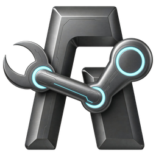

# ArmSwing

**VRChat 풀바디 트래킹에서 팔을 자연스럽게 흔들며 걷기.**

[English](README.md) | [日本語](README.ja.md) | 한국어 | [简体中文](README.zh-CN.md) | [Español](README.es.md) | [Português (BR)](README.pt-BR.md) | [Русский](README.ru.md)

VRChat에서 풀바디 트래킹으로 스틱 이동을 하면 몸은 미끄러지듯 움직이는데 팔은
뻣뻣하게 굳어 있습니다. ArmSwing은 걷는 동안 내리고 있는 팔을 VRChat 자체의
걷기 애니메이션에 맡겨서 팔이 자연스럽게 흔들리게 합니다. 손을 들거나 그립 또는
트리거를 누르면, 그 팔은 같은 프레임에 다시 컨트롤러를 따라갑니다.

## 요구 사항

- Windows 10(버전 1809 이상) 또는 Windows 11, SteamVR
- VRChat(Steam 버전)에서 **풀바디 트래킹 캘리브레이션 완료**: 트래커, SlimeVR,
  Standable 등 VRChat이 풀바디로 캘리브레이션하는 것이면 무엇이든
- 스틱이 있는 컨트롤러([지원 컨트롤러](#지원-컨트롤러) 참고)
- **VRChat의 OSC 켜기**: 액션 메뉴(Action Menu) > Options > OSC > Enabled

풀바디 트래킹이 없으면(3점 트래킹) ArmSwing은 팔을 평소처럼 트래킹된 상태로
둡니다. 3점 트래킹 지원은 개발 중입니다.

## 설치

1. SteamVR을 종료합니다.
2. zip 전체를 옮기지 않을 폴더에 압축 해제합니다(예: `C:\Tools\ArmSwing`).
   `armswing` 폴더, `install.bat`, `uninstall.bat`, README 파일이 있어야
   합니다.
3. `install.bat`을 더블 클릭합니다.
4. SteamVR을 실행한 다음 `armswing\armswing.exe`를 실행합니다.

창은 열리지 않습니다. ArmSwing은 시스템 트레이(시계 옆)에서 실행됩니다.
종료하려면 아이콘을 마우스 오른쪽 버튼으로 클릭하세요. SteamVR을 닫으면
자동으로 종료됩니다.

**업데이트:** SteamVR을 종료하고 새 zip을 압축 해제한 뒤, 그 안의
`install.bat`을 실행합니다. 이전 복사본의 등록은 자동으로 해제됩니다. 그런 다음
이전 폴더를 삭제하세요.

**Windows 경고가 나타나면:** ArmSwing은 아직 코드 서명이 되어 있지 않아서
`install.bat`이나 `armswing.exe`를 실행할 때 Windows SmartScreen이
"Windows의 PC 보호"를 표시할 수 있습니다. **추가 정보**를 클릭한 다음
**실행**을 클릭하세요. 드라이버가 다른 SteamVR 드라이버 애드온과 같은 방식으로
SteamVR에 연결되기 때문에 일부 백신 프로그램이 이를 감지할 수도 있습니다.
전체 소스 코드가 공개되어 있으며, 각 릴리스에 SHA-256 체크섬이 함께 제공되어
다운로드한 파일이 원본인지 확인할 수 있습니다.

## 사용 방법

- 팔을 내린 채 왼쪽 스틱으로 걸으면 팔이 흔들립니다.
- 팔을 대략 허리 높이 위로 들거나 그립 또는 트리거를 누르면, 걷는 도중에도 그
  팔은 즉시 컨트롤러를 따라갑니다.
- 스틱을 밀고 있어도 VRChat에서 실제로 이동하지 않을 때(벽을 향해 걸을 때,
  카메라 비행 모드, 앉아 있을 때, 아주 낮게 웅크렸을 때)는 팔이 트래킹된 상태로
  유지됩니다.
- ArmSwing은 실행 중인 동안 모든 SteamVR 게임에서 작동합니다. 다른 게임을 하기
  전에는 트레이 아이콘에서 종료하세요.

## 지원 컨트롤러

별도 설정 없이 바로 사용 가능: PlayStation VR2 Sense, Meta Quest 및 Rift Touch
(Quest Link, Air Link, Steam Link, Virtual Desktop, ALVR), Valve Index,
Steam Frame, Vive Cosmos, HP Reverb G2, Windows Mixed Reality. Pico와
Vive Focus 3 / XR Elite 컨트롤러(Steam Link 사용)는 자동으로 Quest 프리셋을
사용합니다.

그 밖의 스틱이 있는 컨트롤러: SteamVR > 설정 > 컨트롤러 > 컨트롤러 바인딩 관리 >
ArmSwing에서 이동용 스틱을 `left_stick_pos`에 바인딩하세요. Vive 완드는
지원하지 않습니다(스틱이 아닌 트랙패드이기 때문입니다).

## 내 환경 확인하기

아래 표에서 자신의 환경을 찾으세요. 설정 항목은 [설정](#설정)에 설명되어
있습니다.

| 내 환경 | 할 일 |
|---|---|
| 위 목록에 있는 컨트롤러 | 아무것도 하지 않아도 됩니다. |
| 그 밖의 스틱이 있는 컨트롤러 | `left_stick_pos`를 바인딩하세요(위 참고). |
| 손을 놓을 수 있는 컨트롤러(Globular Cluster 같은 스트랩, 느슨한 Index 스트랩) | 선택 사항: `wake_mode=touch`로 하면 손이 컨트롤러에 닿아 있는 동안 그 팔이 내 것으로 유지됩니다. |
| 팔을 내려도 흔들리지 않음 | `raise_drop`을 작게 하세요(예: `0.50`). |
| 팔을 유지하고 싶은데 흔들림 | `raise_drop`을 크게 하세요(예: `0.90`). |
| 풀바디 트래킹 없음(3점 트래킹) | 아직 지원하지 않습니다. 팔은 평소처럼 트래킹됩니다. |
| 오른쪽 스틱으로 이동함 | 아직 지원하지 않습니다. |
| Steam 버전이 아닌 VRChat, 또는 VRChat의 OSC가 꺼짐 | 스틱을 밀면 벽 앞이나 메뉴에서도 팔이 흔들립니다. 모든 기능을 쓰려면 Steam 버전에서 OSC를 켜세요. |
| 설치 폴더 이름에 특수 문자가 있음(이모지, Windows 언어와 다른 문자) | `C:\Tools\ArmSwing` 같은 단순한 경로에 설치하세요. |

## 설정

`armswing\config.txt`를 텍스트 편집기로 수정합니다. VR 중에 저장해도 되며,
약 1초 안에 적용됩니다.

| 설정 | 기본값 | 설명 |
|---|---|---|
| `raise_drop` | `0.70` | 헤드셋에서 몇 미터 아래까지를 "팔을 든 것"으로 볼지. 작을수록 팔을 유지하려면 더 높이 들어야 합니다. |
| `wake_mode` | `grip` | `grip`: 그립이나 트리거를 누르고 있으면 어떤 높이에서도 팔이 내 것으로 유지됩니다. `touch`: 터치 센서도 포함됩니다. 스트랩 등으로 손을 놓을 수 있는 컨트롤러에서만 사용하세요. |
| `wake_hold` | `120` | 그립이나 트리거를 놓은 뒤 팔이 내 것으로 유지되는 시간(ms). |
| `walk_hold` | `90` | 팔이 흔들리기 시작하기 전까지 스틱을 밀고 있어야 하는 시간(ms). 스틱의 작은 떨림을 무시합니다. |

제거하지 않고 ArmSwing을 끄려면 `armswing\mode.txt`에 `off`라고 쓰세요(`9`라고
쓰면 다시 켜집니다).

## 문제 해결

트레이 아이콘에 마우스를 올리면 상태가 표시됩니다. 로그는 `armswing` 폴더에
있습니다: `armswing-watcher.log`(트레이 앱)와 `armswing.log`(SteamVR 드라이버).
이전 세션의 로그는 `*.prev`로 보관됩니다.

- **벽 앞, 메뉴, 카메라 모드에서 팔이 흔들림:** VRChat의 OSC가 꺼져 있습니다.
  켜 주세요(Action Menu > Options > OSC > Enabled). 정상 작동하면
  `armswing-watcher.log`에 `VRChat's OSC arriving`이 표시됩니다.
- **팔이 전혀 흔들리지 않음:** `armswing-watcher.log`에서
  `[stick] action INACTIVE`를 찾아보세요. 사용 중인 컨트롤러에 맞는 바인딩이
  없다는 뜻입니다([지원 컨트롤러](#지원-컨트롤러) 참고). VRChat에서 풀바디
  트래킹이 캘리브레이션되어 있는지도 확인하세요.
- **한쪽 팔만 흔들리지 않음:** 그 팔의 그립이나 트리거를 누르고 있거나, 손에
  쥐는 컨트롤러에서 `wake_mode=touch`를 사용하고 있을 수 있습니다.
- **그 밖의 문제:** 이슈를 열고 `armswing-watcher.log`, `armswing.log`와 각각의
  `.prev` 파일을 첨부해 주세요.

## 호환성과 개인정보

- **다른 OSC 앱**(VRCFaceTracking 등)은 그대로 작동합니다. ArmSwing은 포트
  9000과 9001을 사용하지 않습니다. VRChat은 OSCQuery로 ArmSwing을 찾아
  ArmSwing 전용 포트로 보냅니다.
- **다른 SteamVR 애드온**도 그대로 작동합니다. ArmSwing이 바꾸는 것은 걷는 동안
  두 손이 트래킹 중으로 보이는지 여부뿐입니다. 장치를 추가하지 않습니다.
- **네트워크:** ArmSwing은 127.0.0.1에서만 수신하므로 PC 외부에서는 접속할 수
  없습니다. VRChat이 찾을 수 있도록, VRChat 및 다른 OSC 앱과 같은 방식으로
  로컬 네트워크에 mDNS로 자신을 알립니다. 인터넷에 연결하지 않으며 어떤 데이터도
  수집하지 않습니다.

## 제거

SteamVR을 종료하고 `uninstall.bat`을 실행한 다음 폴더를 삭제합니다.

## 소스에서 빌드

[영어 README](README.md#building-from-source)를 참고하세요.
