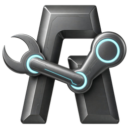

# ArmSwing

**Естественное покачивание рук при полнотелом трекинге в VRChat.**

[English](README.md) | [日本語](README.ja.md) | [한국어](README.ko.md) | [简体中文](README.zh-CN.md) | [Español](README.es.md) | [Português (BR)](README.pt-BR.md) | Русский

В VRChat с полнотелым трекингом (FBT) при ходьбе стиком тело скользит вперёд,
а руки остаются застывшими. ArmSwing во время ходьбы передаёт опущенные руки
собственной анимации ходьбы VRChat, и они естественно покачиваются. Поднимите
руку или зажмите её грип или курок — и эта рука в том же кадре снова следует
за контроллером.

## Требования

- Windows 10 (версия 1809 или новее) или Windows 11, SteamVR
- VRChat (версия из Steam) с **откалиброванным полнотелым трекингом**:
  трекеры, SlimeVR, Standable или что угодно, что VRChat калибрует как
  полнотелый трекинг
- Контроллер со стиком (см. [Поддерживаемые контроллеры](#поддерживаемые-контроллеры))
- **Включённый OSC в VRChat**: меню действий (Action Menu) > Options > OSC > Enabled

Без полнотелого трекинга (3 точки) ArmSwing оставляет руки отслеживаемыми как
обычно. Поддержка 3-точечного трекинга в разработке.

## Установка

1. Закройте SteamVR.
2. Распакуйте весь zip в постоянную папку, например `C:\Tools\ArmSwing`.
   В ней должны быть папка `armswing`, `install.bat`, `uninstall.bat` и файлы
   README.
3. Дважды щёлкните `install.bat`.
4. Запустите SteamVR, затем `armswing\armswing.exe`.

Окно не открывается: ArmSwing работает в системном трее, рядом с часами.
Чтобы выйти, щёлкните значок правой кнопкой мыши. Программа сама закрывается
вместе со SteamVR.

**Обновление:** закройте SteamVR, распакуйте новый zip и запустите его
`install.bat`. Он сам снимет регистрацию старых копий. Затем удалите старую
папку.

**Если Windows показывает предупреждение:** у ArmSwing пока нет цифровой
подписи, поэтому при запуске `install.bat` или `armswing.exe` Windows
SmartScreen может показать «Система Windows защитила ваш компьютер». Нажмите
**Подробнее**, затем **Выполнить в любом случае**. Некоторые антивирусы также
могут реагировать на драйвер, потому что он подключается к SteamVR так же, как
другие драйверные дополнения. Весь исходный код открыт, а к каждому выпуску
прилагаются контрольные суммы SHA-256, чтобы вы могли убедиться, что скачали
оригинал.

## Использование

- Идите левым стиком с опущенными руками — руки покачиваются.
- Поднимите руку примерно выше пояса или зажмите её грип или курок — эта рука
  сразу снова следует за контроллером, даже на ходу.
- Если стик нажат, но VRChat на самом деле вас не двигает (вы идёте в стену,
  режим полёта камеры, сидите, присели очень низко), руки остаются
  отслеживаемыми.
- Пока ArmSwing запущен, он работает во всех играх SteamVR. Перед тем как
  играть во что-то другое, закройте его через значок в трее.

## Поддерживаемые контроллеры

Работают сразу, без настройки: PlayStation VR2 Sense, Meta Quest и Rift Touch
(Quest Link, Air Link, Steam Link, Virtual Desktop, ALVR), Valve Index,
Steam Frame, Vive Cosmos, HP Reverb G2, Windows Mixed Reality. Контроллеры
Pico и Vive Focus 3 / XR Elite (через Steam Link) автоматически используют
пресет для Quest.

Другие контроллеры со стиком: в SteamVR > Настройки > Контроллеры >
Управление привязками контроллеров > ArmSwing назначьте стик передвижения на
`left_stick_pos`. Контроллеры Vive (wands) не поддерживаются: у них трекпад, а
не стик.

## Проверьте свою конфигурацию

Найдите свой случай в таблице. Упомянутые параметры описаны в разделе
[Настройки](#настройки).

| Ваш случай | Что делать |
|---|---|
| Контроллер из списка выше | Ничего. |
| Другой контроллер со стиком | Назначьте `left_stick_pos` (см. выше). |
| Контроллеры, которые можно отпустить (на ремешке, например Globular Cluster, ослабленные ремешки Index) | По желанию: `wake_mode=touch`, чтобы рука оставалась вашей, пока ладонь касается контроллера. |
| Опущенные руки не покачиваются | Уменьшите `raise_drop` (например, `0.50`). |
| Руки покачиваются, когда вы хотите оставить их своими | Увеличьте `raise_drop` (например, `0.90`). |
| Нет полнотелого трекинга (3 точки) | Пока не поддерживается: руки остаются отслеживаемыми как обычно. |
| Вы передвигаетесь правым стиком | Пока не поддерживается. |
| VRChat не из Steam или выключен OSC в VRChat | Руки покачиваются всякий раз, когда нажат стик, даже у стены и в меню. Для полной работы используйте версию из Steam с включённым OSC. |
| Путь к папке установки с необычными символами (эмодзи или алфавит, отличный от языка Windows) | Установите в простую папку, например `C:\Tools\ArmSwing`. |

## Настройки

Отредактируйте `armswing\config.txt` в любом текстовом редакторе. Сохранять
можно прямо в VR: изменения применяются примерно за секунду.

| Параметр | По умолчанию | Что делает |
|---|---|---|
| `raise_drop` | `0.70` | На сколько метров ниже шлема рука считается поднятой. Меньше — руку нужно поднимать выше, чтобы она оставалась вашей. |
| `wake_mode` | `grip` | `grip`: зажатый грип или курок оставляет руку вашей на любой высоте. `touch`: учитываются и сенсоры касания; только для контроллеров, которые можно отпустить (на ремешке). |
| `wake_hold` | `120` | Сколько миллисекунд рука остаётся вашей после того, как вы отпустили грип или курок. |
| `walk_hold` | `90` | Сколько миллисекунд стик должен быть нажат, прежде чем руки начнут покачиваться. Игнорирует случайные касания стика. |

Чтобы выключить ArmSwing без удаления, напишите `off` в `armswing\mode.txt`
(напишите `9`, чтобы снова включить).

## Решение проблем

Наведите курсор на значок в трее, чтобы увидеть состояние. Логи лежат в
папке `armswing`: `armswing-watcher.log` (приложение в трее) и `armswing.log`
(драйвер SteamVR). Логи предыдущего сеанса сохраняются как `*.prev`.

- **Руки покачиваются у стены, в меню или в режиме камеры:** в VRChat
  выключен OSC. Включите его (Action Menu > Options > OSC > Enabled). Когда
  всё работает, в `armswing-watcher.log` появляется `VRChat's OSC arriving`.
- **Руки никогда не покачиваются:** найдите `[stick] action INACTIVE` в
  `armswing-watcher.log`. Это значит, что для вашего контроллера не нашлось
  подходящей привязки; см.
  [Поддерживаемые контроллеры](#поддерживаемые-контроллеры). Также проверьте,
  что полнотелый трекинг откалиброван в VRChat.
- **Одна рука никогда не покачивается:** возможно, вы держите её грип или
  курок, или используете `wake_mode=touch` с контроллером, который держите в
  руке.
- **Что-то другое:** создайте issue и приложите `armswing-watcher.log` и
  `armswing.log`, а также их копии `.prev`.

## Совместимость и конфиденциальность

- **Другие OSC-приложения** (VRCFaceTracking и другие) продолжают работать:
  ArmSwing никогда не использует порты 9000 и 9001. VRChat находит его через
  OSCQuery и отправляет данные на собственный порт ArmSwing.
- **Другие дополнения SteamVR** продолжают работать: ArmSwing меняет только
  то, считаются ли ваши руки отслеживаемыми во время ходьбы. Устройств он не
  добавляет.
- **Сеть:** ArmSwing принимает соединения только на 127.0.0.1, поэтому снаружи
  вашего ПК к нему подключиться нельзя. Чтобы VRChat мог его найти, он
  объявляет о себе через mDNS в локальной сети — так же, как VRChat и другие
  OSC-приложения. Он никогда не подключается к интернету и не собирает никаких
  данных.

## Удаление

Закройте SteamVR, запустите `uninstall.bat` и удалите папку.

## Сборка из исходного кода

См. [README на английском](README.md#building-from-source).
